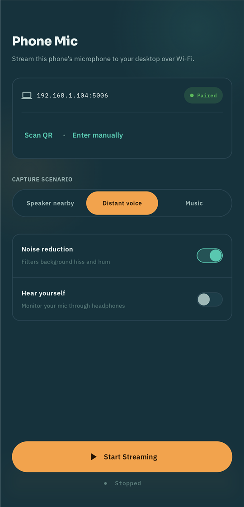
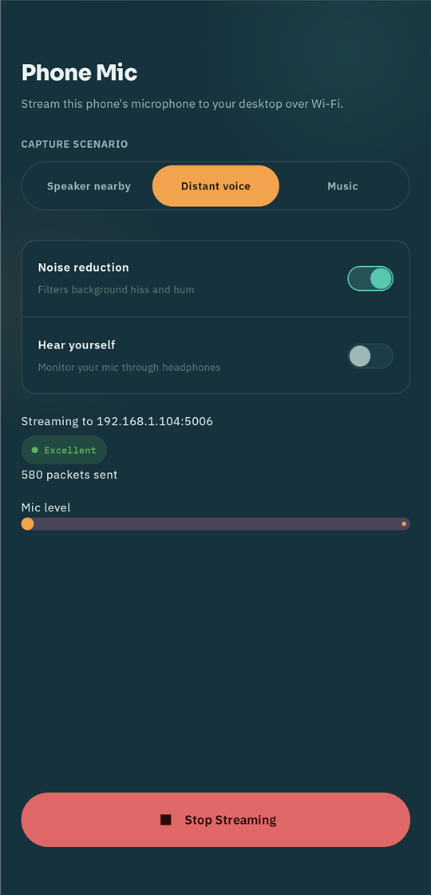
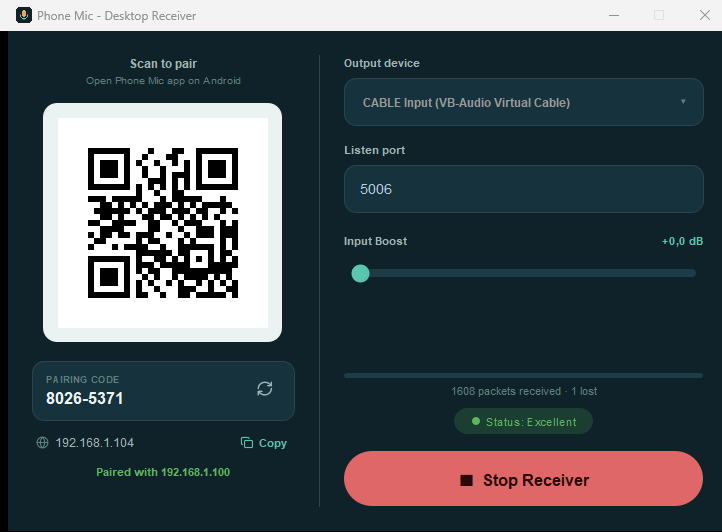

# Phone Mic

Turns an Android phone into a wireless microphone for a Windows or macOS desktop — for
game/Discord voice chat when a wired mic dies, or you just don't have one nearby. No
cloud, no account, everything stays on your WiFi network.

**[Website + downloads](https://harunethm.github.io/phonemic/)** · **[Releases](https://github.com/harunethm/phonemic/releases)**

## Screenshots

  
  &nbsp;
  

  

## What's here

- [`PhoneMic-Android/`](PhoneMic-Android) — the phone app (Kotlin/Compose).
- [`PhoneMic-Desktop/`](PhoneMic-Desktop) — the desktop receiver (Kotlin/JVM, Windows + macOS).

Each has its own README with build instructions. Most people just want a prebuilt
download from the [website](https://harunethm.github.io/phonemic/) — the source here
is for anyone who wants to read it, build it themselves, or contribute.

## How it works

The phone captures mic audio and streams it over WiFi (UDP) to the desktop app, which
plays it into a virtual audio cable — so it shows up as a real microphone in Discord,
your game, or anywhere else. Pairing is a QR code + PIN generated by the desktop app;
there's no server or relay involved at any point.

## Contributing

Issues and pull requests welcome — see [Report an issue](https://github.com/harunethm/phonemic/issues).
